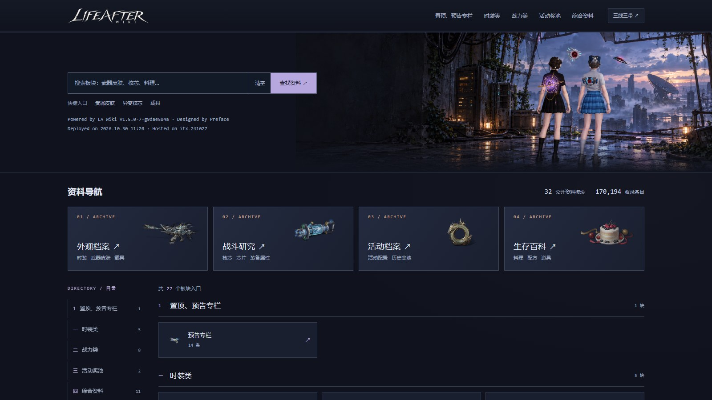
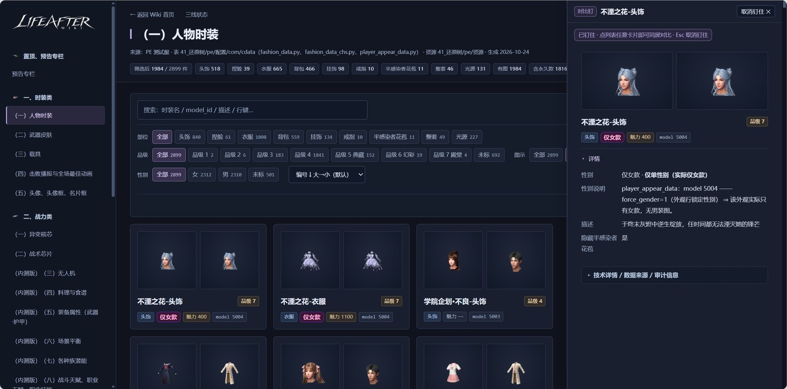
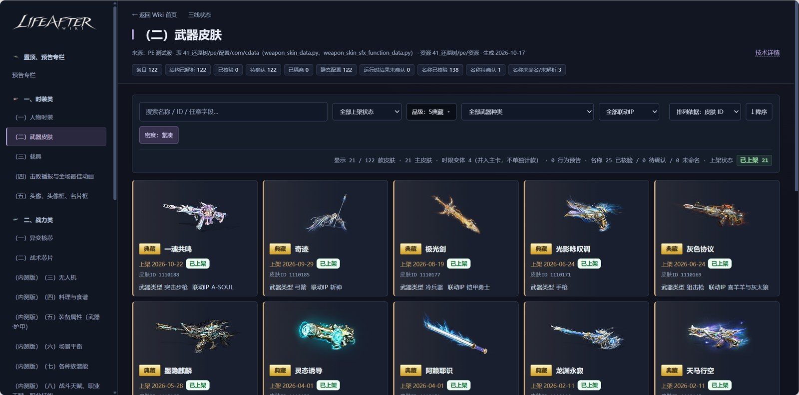
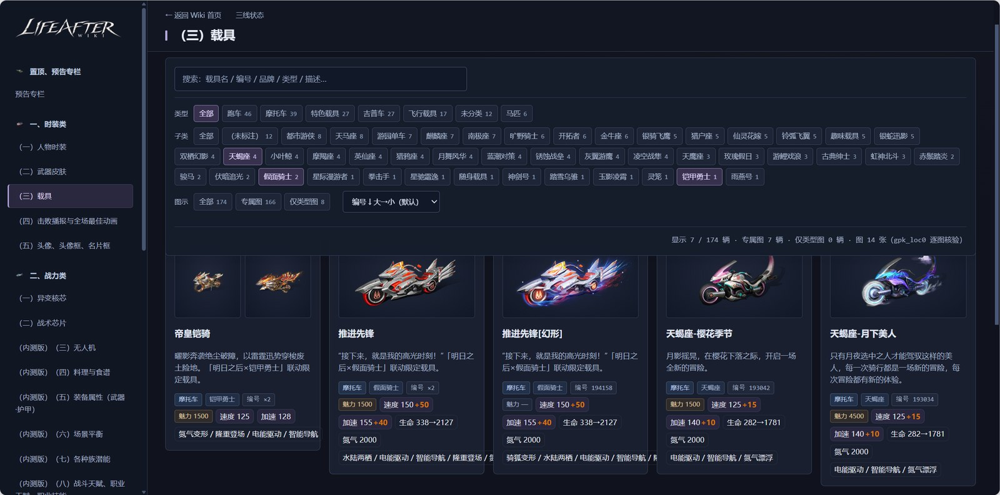
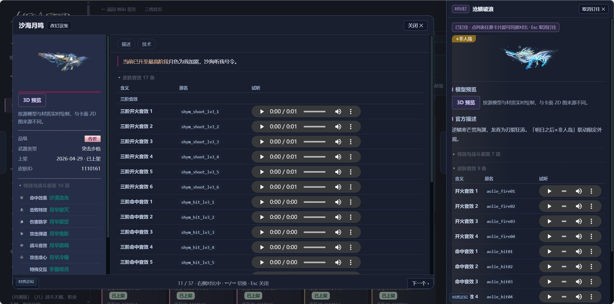
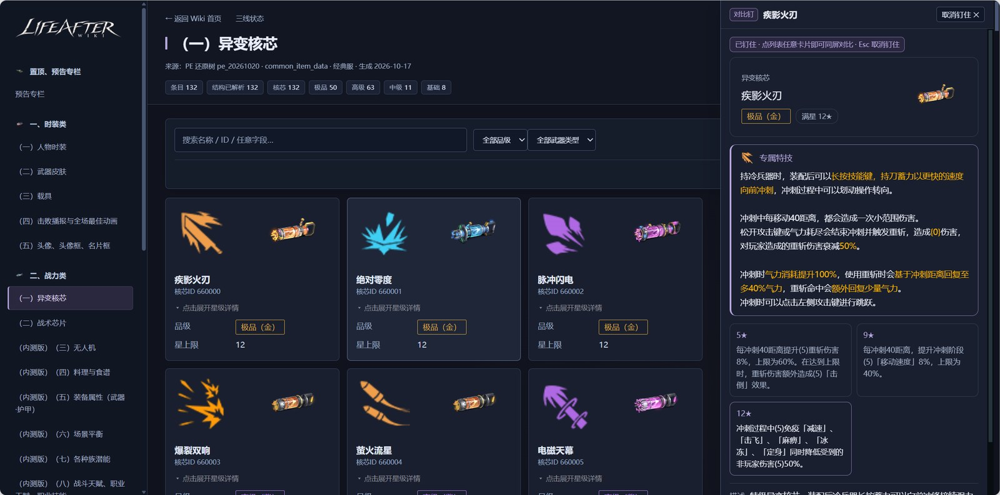
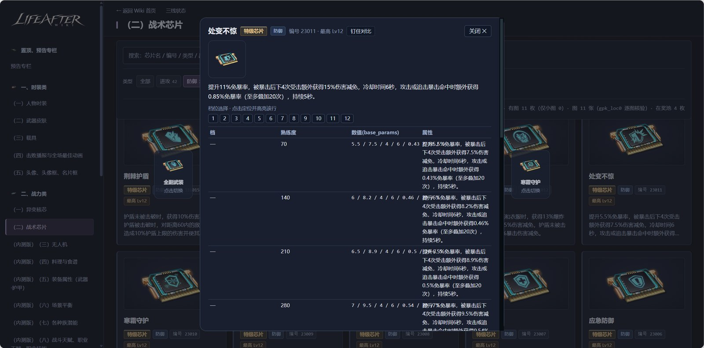
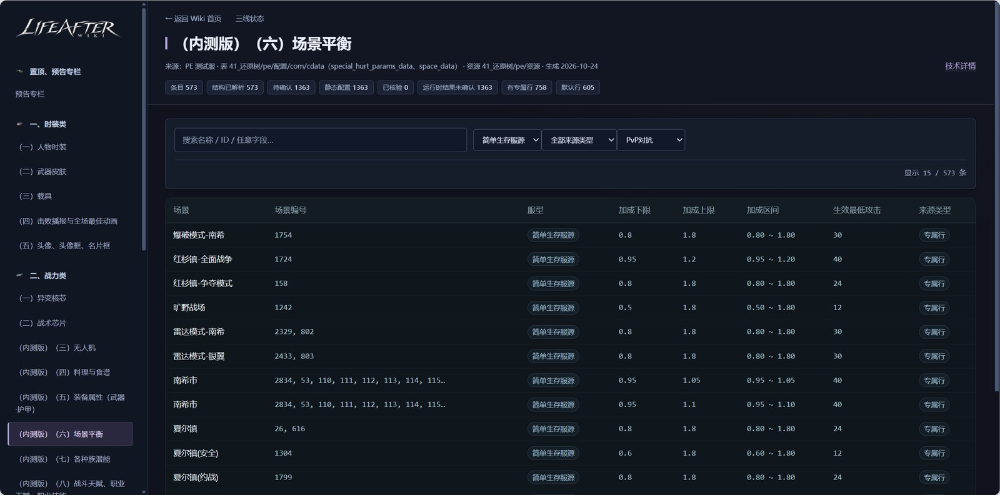

# 明日之后 拆包工作台 · LA Wiki

**把《明日之后》客户端拆成可查询的图鉴。**

- **31 个板块 / 170,144 条数据**，每条带行级来源
- 流程：拆包 → 解码 → 建板 → 发布，一条命令链跑完
- 可复现：换台机器 clone 代码，用**自己设备**的拆包产物，可构建出一样的 wiki
  （验收命令见 [「从零复现 wiki」](#从零复现-wiki)）

> 现行源 = **PE 测试服（雷电模拟器 `com.netease.mrzh`）**。PC 测试服源只作对照，
> 两套的容器编号与 fid 体系并不完全相通，**服别不可混用**。

---

## 它是什么

一套《明日之后》拆包与图鉴生产工具链：

```
原始包 → 索引 → 还原树 → 配置表解码 → 图鉴板块 → 站点
```

- PE 182 包 / 180 万行索引，配置表解码 12,000+ 张
- 逻辑路径 → fid → 容器 + 行号；2D 图按档位与像素取最高清
- 每条数据带行级溯源；还原树 / 索引 / 板块都能从客户端重建

## 主要能力：定位 + 渲染

> 核心是两件事：把资源从**海量容器里精确定位**出来，再**按游戏原样呈现**。

| 领域 | 能做什么 |
|---|---|
| **时装** | 整装与部件（衣 / 头饰 / 背包 / 光源），性别分轨，材质槽位 |
| **武器皮肤** | 皮肤模型 + 材质 + 贴图，音效真名与音频提取 |
| **载具** | 类型 / 子类、模型与图标 |
| **奖池 / 活动** | 奖池定义、掉落权重、每期选品与新品下发 |
| **场景 / 展示台** | 预览场景（网格 + 贴图 + 天气 + 相机 + 光照） |
| **音效 / 特效** | `.sfx` 轨道、特效部件、FSB 采样与 WAV |
| **配置表 / 图集** | BinDict 表解码、spine 图集、中文字表 |

### 测试服源 ⇒ 能定位「未上线内容」

```
测试服（playertest）先于正式服下发新皮肤 / 新时装 / 新奖池
手上有测试服客户端 + 对应热更源，就能做正式服 vs 测试服的 fid 级 diff
判据与切服方法见 00_规范与工具/治理/手册/CDN-AND-VERSION.md
```

---

## 效果预览

**① Wiki 首页** —— 31 个公开板块、170,144 条记录，按四类档案归档，顶部展示构建版本与部署信息；
搜索框可直接跳板块，快捷入口直达武器皮肤 / 异变核芯 / 载具



**② 人物时装** —— 2,899 件候选（含捏脸、戒指、半感染者花苞等小类），默认勾选「仅显示玩家可使用时装」
过滤混入的开发名，可取消勾选查看全量；部位 / 品级 / 性别 / 编号多维筛选，卡面标品级、魅力值、model



**③ 武器皮肤** —— 122 款，卡片直出 3D 渲染；弹窗内可看特效与战斗表现（游戏内正式名 + 备注名）
与**皮肤音效逐条试听**（含开火 / 命中 / 击败 / 切枪语音）



**④ 载具** —— 174 辆，按类型（跑车 / 摩托车 / 特色载具 / 吉普车 / 飞行载具 / 马匹）与子类筛选；
卡面给出**速度上限、加速度、生命值、氮气、专属特性 tag**，含联动 IP 与编号



**⑤ 子卡对比** —— 任意卡片「弹出大子卡」查看全量信息；点「钉住对比」置右，左侧再选一张即可
双卡并列对比（←/→ 切换，Esc 退出）



**⑥ 异变核芯** —— 132 条，核芯与 5★ / 9★ / 12★ 特技合并展示；品级、星上限、专属特技逐条标注，
支持经典服范围的 12 星



**⑦ 战术芯片** —— 按类型（进攻 / 防御）与编号筛选；弹窗内按档位（1–12 档）列出熟练度与
`base_params` 数值，并高亮当前档位



**⑧ 伤害场景平衡** —— 573 行场景加成档位，可按服型（经典服 / 简单生存服）、来源类型、PvP/PvE 筛选；
给出加成上下限、加成区间与生效最低攻击



---

## 三线三带

站点首页有一段「三线三带」，用来讲这套项目自己的结构：三条线是**索引线 / 定位线 / 呈现线**，
三条带是**输入带（源包） / 还原带（还原树与索引） / 输出带（板块与页面）**。
它在站内是可点的结构图，这里只用文字交代，不重复截图。

---

## 更新通知

### 2026-10-30 · wiki优化
1、wiki子卡详情页大迭代：


（1）从单击“展开详情“改为单击”弹出大子卡“，信息更全面，便于浏览

（2）大子卡支持“对比功能”，点击钉住对比后将自动置于右侧，可在左侧再选中一张进行双子卡对比

2、wiki内容优化


（1）优化了2d图的定位&取图逻辑

（2）大幅扩充了"人物时装"板块的候选表，新增了包括且不限捏脸、戒指、半感染者花瓣。但因混入大量石山，现默认勾选"仅显示玩家可使用时装"来过滤，想品尝原汁原味的可以取消勾选。

（3）优化了武器皮肤音频提取，优化了播放器

（4）新增载具参数，包括速度上限、加速度、生命值、氮气、tag描述

（5）更换了异变核芯、战术芯片的源，现在支持到经典服范围的12星了，而非之前简单生存服的上限（ps：跪求经典服的pr作业，作者主玩简单生存服真的懒得搞经典服）

（6）初步优化了头像、头像框、名片框的渲染，但动图和名片框的渲染还是史，后续有缘还会优化的

（7）初步定位、设计了其他板块，增加了若干带（内测版）tag的板块，内测版板块都是仅初步定位，还未筛选，审查格式等等，仅供参考，数据可用性待后续维护

---

## 快速开始

```bash
# 0) 依赖
python -m venv 00_规范与工具/环境/venv
00_规范与工具/环境/venv/Scripts/pip install -r 00_规范与工具/环境/requirements.lock.txt

# 1) 每次开工必做：共享核心进 PYTHONPATH
export PYTHONPATH="$PWD/00_规范与工具/工具/工具库/00_共享核心"      # Linux/macOS
set PYTHONPATH=%CD%\00_规范与工具\工具\工具库\00_共享核心           # Windows cmd

# 2) 自检
python la.py doctor

# 3) 起站
python 02_wiki/web/tools/wiki_server.py --host 0.0.0.0 --port 8765
```

> ⚠️ 不加 `PYTHONPATH` 会报 `ModuleNotFoundError: No module named 'toolkit_core'`。

---

## 从零复现 wiki

> **目标**：你 clone 仓库后，用**自己设备**的拆包产物，能构建出**一样的** wiki。

### 三层结构

| 层 | 位置 | 是否入库 | 说明 |
|---|---|---|---|
| **代码层** | `00_规范与工具/`、`02_wiki/` | ✅ 入库 | 脚本 + 页面 + 规则层 |
| **产物层** | `01_索引与产物/` | ❌ 不入库 | 你的拆包产物（数百 GB，可重建） |
| **数据层** | `02_wiki/web/data/boards/` | ✅ 入库 | 板数据（克隆即可直接浏览） |

**克隆后你立刻能浏览 wiki**（数据层已入库），无需任何拆包。
要**自己重建**，则需要用自己的客户端产出替换产物层。

### 一、只浏览（无需拆包）

```bash
git clone https://github.com/lespre/lifeafter-toolkit.git
cd lifeafter-toolkit
python 02_wiki/web/tools/wiki_server.py --host 127.0.0.1 --port 8765
```

浏览器打开 <http://127.0.0.1:8765/wiki.html>。

> 💡 解密库（`cryptography`）是**可选依赖**：只影响「热更实时读取」，
> 不装也能完整浏览静态站与全部已发布板块。

### 二、用自己的设备重建

```bash
# 1) 指明你的客户端安装目录（PE 测试服在雷电模拟器里）
export LA_CLIENT_ROOT="你的客户端目录"          # Linux/macOS
set LA_CLIENT_ROOT=你的客户端目录                 # Windows cmd

# 2) 装依赖 + 挂 PYTHONPATH（见「快速开始」）

# 3) 建索引 → 物化还原树 → 解码 → 建板 → 发布
python la.py index all
python la.py board run            # 建板（可跟板名，如 `la.py board run vehicle_full`）
python la.py web build            # 发布校验 + 生成 manifest

# 4) 验收：跟入库数据对一遍，确认你的产物与本仓库一致
python 02_wiki/web/tools/checks/clone_repro_check.py
```

### 三、验收标准

`clone_repro_check.py` 跑五道关，全绿即「可复现」：

| 关卡 | 检查什么 | 通过标准 |
|---|---|---|
| **G1** 冷克隆完整性 | 只取 git 入库内容后关键目录是否齐备 | `la.py` / 共享核心 / 已发布板数据都在 |
| **G2** 无依赖起站 | 不装 `cryptography` 能否起站 | 页面全部 200 |
| **G3** 路径可移植性 | 脚本里有没有写死绝对路径 | 合规率 100%（探查类脚本除外） |
| **G4** 条目指纹可复现 | 重建产物与入库数据是否一致 | 条目指纹一致率 ≥ 99% |
| **G5** 发布门禁 | 发布契约是否通过 | `build_wiki.py` exit 0 |

### 四、两个环境变量

| 变量 | 作用 | 默认 |
|---|---|---|
| `LA_ROOT` | 仓库根（脚本按此定位所有路径） | 自动探测 |
| `LA_CLIENT_ROOT` | 你的客户端安装目录 | `E:/mrzh`（仅测试服常见布局） |

路径规则详见 [`02_wiki/rules/portability.yml`](02_wiki/rules/portability.yml)：
**仓库自身路径**必须从根推导；**你的设备路径**必须走环境变量；
**写进产物元数据的溯源路径**保持字面量（否则每次构建产物都不同，破坏可复现）。

---

## 用 Agent 快速接手

把仓库丢给任意 Agent，先让它读这四份：

```text
README.md                            ← 全貌 + 两类条目 + 资源定位四步法
00_规范与工具/治理/手册/CLI.md        ← 命令清单，别自己造轮子
00_规范与工具/治理/手册/USAGE.md      ← 实战工作流 + 验收纪律
00_规范与工具/治理/手册/AGENT.md      ← 冷启动手册
```

### 四条硬规矩

| 规矩 | 原因 |
|---|---|
| **`0 命中` 先怀疑代码** | 函数用错、偏移错、路径写法错 —— 多数是代码问题 |
| **引用逐字读** | 一个字符不同 ⇒ `murmur3` fid 全变 ⇒ 必然 0 命中 |
| **哈希自证** | 拿已知命名文件算 fid 必须命中；不中 = 方法错 |
| **`.png` 未命中先换扩展名** | UI 图标在 PE 是 `.ktx`、PC 是 `.bc7` |

> 源包只读 / 服别不混 / 不编数据。

---

## 核心概念：两类条目

| 类型 | fid 来源 | 定位方式 |
|---|---|---|
| **有名条目** | `murmur3_x86_32(路径)` 双 seed（高 `0x77777777`、低 `0x66666666`） | 算哈希 ⇒ 直接命中容器行 |
| **无名条目** | 引擎内部 id，**不是**路径哈希 | ① 邻接 ② `.c159`/`.mtg` 槽位 ③ 通道统计 |

### 无名贴图的身份判定（纯数学）

| 特征 | 判定 |
|---|---|
| `R≈G≈128` 且 `B>200` | 法线图 |
| ≥2 个通道 `std<1.5` | 单通道数据图 |
| `R` 恒 255 | 参数图 |
| `R/G` 相关 `>0.8` 且饱和 `>40` | 基色图 |

---

## 资源定位四步法

```text
① 读引用   从 .mtg / .c159 逐字抽路径串（绝不手打）
           正则：[\x20-\x7E]{5,220}\.(tga|dds|png|cube|array|ktx)
② 算哈希   path → 16 位 hex fid
③ 锚定行   fid ⇒ (容器, 行号, 偏移, 解压后尺寸)
④ 判身份   无名条目 ⇒ 邻接 / 槽位语义 / 通道统计
```

---

## CLI 命令总览

完整参数见 [`00_规范与工具/治理/手册/CLI.md`](00_规范与工具/治理/手册/CLI.md)。

### 索引与定位

```bash
toolkit_cli.py index build            # 建统一文件索引
toolkit_cli.py verify                 # 索引 + 已知路径端到端自检
toolkit_cli.py names lookup <路径>     # 游戏内路径 → 包 / 行
toolkit_cli.py locate --fid <hex>     # fid 反查容器与行
toolkit_cli.py extract <容器> <行号>   # 定点提取
toolkit_cli.py materialize            # 产物 → 还原树（硬链接，幂等）
```

### 资源提取与解码

```bash
toolkit_cli.py bulk <目标> --out <目录>   # 批量提取：断点续跑
toolkit_cli.py tex <dds目录> --out <目录> # 贴图 → PNG（DDS/BC7/KTX）
toolkit_cli.py audio <sfx> --out <目录>   # 音效轨道 → 帧表
toolkit_cli.py glb <mesh...> --out a.glb  # .mesh → GLB
toolkit_cli.py sheet <.c159>              # 装配帧 → 材质 / 部件表
```

### 热更与散文件层

```bash
python 00_规范与工具/工具/run_all.py detect
python 00_规范与工具/工具/run_all.py hotfix plan --client-root "E:\mrzh"
toolkit_cli.py loose scan --out <目录>    # 散文件层 .idx/.wpk 解密
toolkit_cli.py loose match --dir <目录>   # 内容 MD5 → 容器 + 行号
toolkit_cli.py delta                      # 正式服 vs 测试服差异
```

### 配置表 / 奖池 / 图集

```bash
toolkit_cli.py tables list|find|chs|refimg
toolkit_cli.py lottery list|find|show|delta
toolkit_cli.py atlas list|discover|export
python la.py pe best <逻辑路径>           # 全部候选，取最高清
python la.py pe export <逻辑路径> out.png
```

### 体检与审计

```bash
toolkit_cli.py overview                   # 全格式概览
toolkit_cli.py decode-audit               # 按容器 × flag 分层抽样
toolkit_cli.py export <输入> --out x.csv  # 解析结果 → 表格
```

---

## 架构总览

```text
源包（只读）  gpk(HPGF) · npk(NXPK) · fpk · 散文件层(idx/wpk) · APK · 热更包
      │ index build
      ▼
01_索引与产物/10_索引    容器条目表 · 行→路径 · 名字字典 · 热更快照
      │ names / locate / find / resolve_asset
      ▼
01_索引与产物/41_还原树  ★ 唯一权威资源树（层级对标真实客户端路径）
      │ tex / glb / sheet / render / audio
      ▼
01_索引与产物/20_提取 · 30_分析      02_wiki/web 可视化（wiki · 3D · 看板）
```

**四条链路**：索引链（源包→条目表）、定位链（路径/fid→行）、还原链（产物→树）、呈现链（树→PNG/GLB/页面）。

---

## 容器格式备忘

| 扩展名 | 格式 |
|---|---|
| `.gpk`（res 族） | `HPGF` · 16B 头 + 块链 + 32B/条 `(off, comp, dec, c1, c2, flag, hash_lo, hash_hi)` |
| `.gpk`（`gres/*`） | 同块链但**多块** ⇒ 必须用 `parse_gpk_gres` |
| `.npk` | `NXPK` · AES-ECB 头/表 + 48B 条目 |
| 热更 `.idx` | `SKPW` · 头 36B + 36B/条 |
| 热更载荷片 | `1DPW` · 魔数 + u32 + 16B MD5 = 文件名 + 加密体 |
| BinDict 表体 | 外层 `x{` + u32(len)；内层 `[count][48B][u32 池长][值流][行体]` |

**值流 tag**：`0x12`=f32 · `0x22`=f64 · `0x03`=bool · `0x0b`=ref · `07 03`=分组

---

## 目录结构

```text
la拆包项目/
├── 00_规范与工具/
│   ├── 治理/                 索引 · 手册 · 规范 · 台账 · 日志 · 参考资料
│   └── 工具/
│       ├── run_all.py        总入口
│       └── 工具库/
│           ├── 00_共享核心/    toolkit_core / 命令行 / 测试
│           ├── 01_解码定位复原/ 解包 · 扫描 · 定位 · 取图
│           ├── 02_图文音频渲染/ 皮肤链 · 3D 预览 · 纹理音频
│           └── 04_热更定位/    热更链 · 切服与 CDN
├── 01_索引与产物/            ✗ 不入库（源包 / 还原树 / 索引库 / 分析产物）
└── 02_wiki/web/              Wiki 实现（页面 · 板块数据 · 工具）
```

---

## 环境要求

- **Python 3.12**（`00_规范与工具/环境/venv`）
- Windows（PE 源在雷电模拟器目录；客户端路径用 `LA_CLIENT_ROOT` 指定，默认 `E:\mrzh`）
- 可选：`astcenc`（KTX/ASTC）、`OIIO`（贴图交叉校验）
- 可选依赖：`cryptography` 等 —— 只影响热更实时读取，**不影响静态站浏览**

---

## 常见坑

| 现象 | 原因 | 解法 |
|---|---|---|
| `ModuleNotFoundError: toolkit_core` | 没设 PYTHONPATH | 见「快速开始」 |
| `ModuleNotFoundError: cryptography` | 缺可选依赖 | 只影响热更实时读取，静态站正常；需装则 `pip install -r 00_规范与工具/环境/requirements.lock.txt` |
| clone 后找不到项目根 | 仓库放得太深 / 缺标记文件 | 设 `LA_ROOT=<仓库路径>` |
| 换机器后读不到客户端 | 客户端路径是本机绝对路径 | 设 `LA_CLIENT_ROOT=<你的客户端目录>` |
| `载荷里找不到 'x{' 表体标记` | payload 不对 | 按 `x{ + u32(len)` 切 |
| `expected_single_block_got_56` | 把 `parse_gpk` 用在 gres 族 | 用 `parse_gpk_gres` |
| `'function' object is not iterable` | `rows` 是函数 | 调 `rows_fn()` |
| 解析结果全 0 | 先怀疑代码 | 用已知命名文件自证 |
| 页面「改了没生效」 | 服务死 / 资源 404 / 报错被吞 | 先探活 → 看网络 → 读 `window.__dbg` |

> 经验法则：`0 命中` 先查代码，后疑数据。4 字节哈希在高熵数据里命中可能只是巧合，必须验完整 8 字节。

---

## 许可与免责

仅供**学习研究**。请遵守游戏用户协议 —— 不修改客户端文件、不动态注入、不连接未授权服务器。
