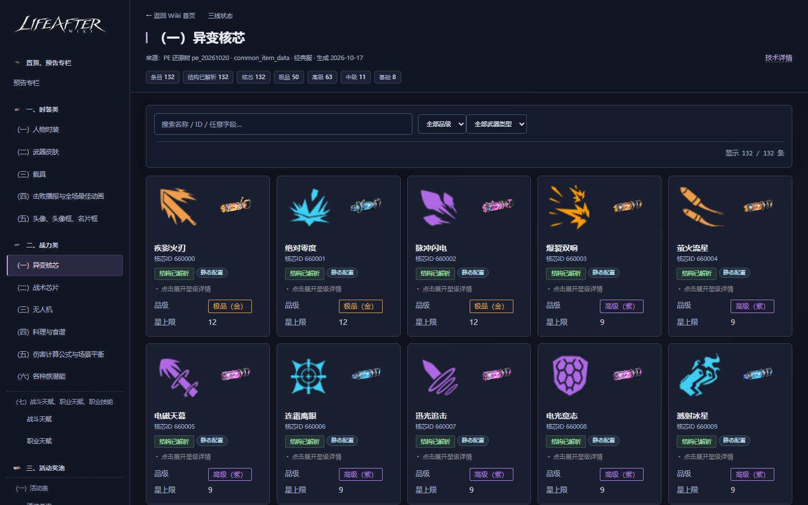
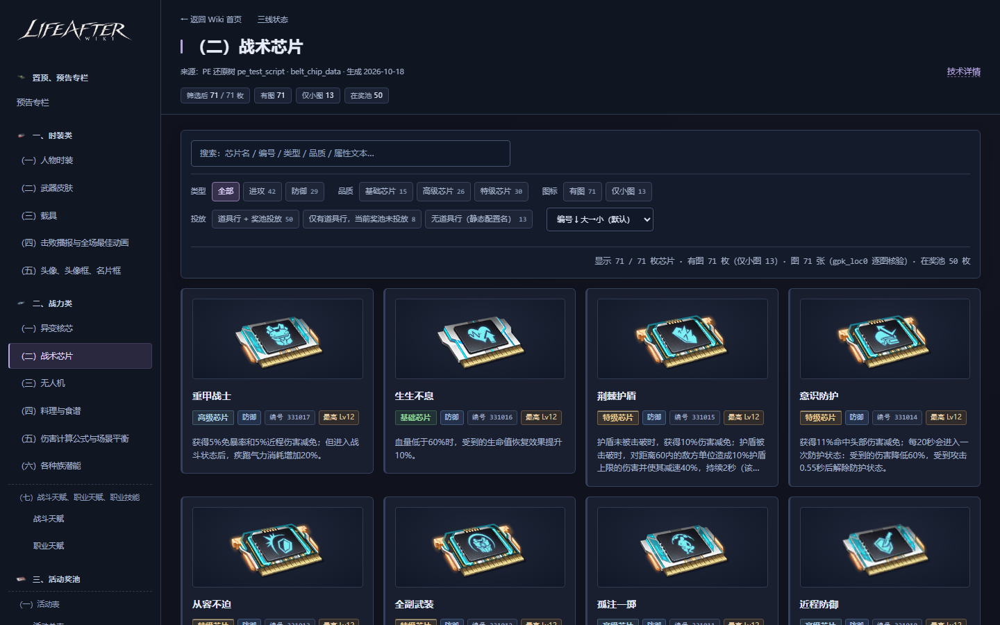

# 明日之后 拆包工作台 · LA Wiki

**把《明日之后》客户端拆成可查询的图鉴。**

- **35 个板块 / 169,014 条数据**，每条带行级来源
- 流程：拆包 → 解码 → 建板 → 发布，一条命令链跑完
- 可复用：换台机器 clone 代码 + 重建索引也能起站

> 现行源 = **PE 测试服（雷电模拟器 `com.netease.mrzh`）**。PC 测试服源只作对照，
> 两套的容器编号与 fid 体系并不完全相通，**服别不可混用**。

---

## 它是什么

一套《明日之后》拆包与图鉴生产工具链：

```
原始包 → 索引 → 还原树 → 配置表解码 → 图鉴板块 → 站点
```

- PE 182 包 / 180 万行索引，配置表解码 12,000+ 张
- 逻辑路径 → fid → 容器 + 行号；2D 图按档位与像素取最高清
- 每条数据带行级溯源；还原树 / 索引 / 板块都能从客户端重建

## 主要能力：定位 + 渲染

> 核心是两件事：把资源从**海量容器里精确定位**出来，再**按游戏原样呈现**。

| 领域 | 能做什么 |
|---|---|
| **时装** | 整装与部件（衣 / 头饰 / 背包 / 光源），性别分轨，材质槽位 |
| **武器皮肤** | 皮肤模型 + 材质 + 贴图，音效真名与音频提取 |
| **载具** | 类型 / 子类、模型与图标 |
| **奖池 / 活动** | 奖池定义、掉落权重、每期选品与新品下发 |
| **场景 / 展示台** | 预览场景（网格 + 贴图 + 天气 + 相机 + 光照） |
| **音效 / 特效** | `.sfx` 轨道、特效部件、FSB 采样与 WAV |
| **配置表 / 图集** | BinDict 表解码、spine 图集、中文字表 |

### 测试服源 ⇒ 能定位「未上线内容」

```
测试服（playertest）先于正式服下发新皮肤 / 新时装 / 新奖池
手上有测试服客户端 + 对应热更源，就能做正式服 vs 测试服的 fid 级 diff
判据与切服方法见 00_规范与工具/治理/手册/CDN-AND-VERSION.md
```

---

## 效果预览

**① 首页** —— 35 个公开板块、169,014 条记录，按五类归档，顶部展示构建版本与部署信息


**② 人物时装** —— 2,782 张卡、1,751 张有图、男图 1,630 张（另有 8 套单性别款不计缺口）；
**可查是否隐藏半感染者花苞、挂件、副武器**；品级 **5 典藏 / 6 幻彩 / 7 殿堂**


**③ 武器皮肤** —— 122 款，121 款带图；品级、上架状态、联动 IP；**可查音效真名与试听**


**④ 场景平衡** —— 573 行（PvP 57 / PvE 516），可按服型、来源、场景类型筛选


**⑤ 异变核芯** —— 132 条，核芯与 12 星特技合并展示，品级与星上限逐条标注



**⑥ 战术芯片** —— 71 条，按芯片类型与品质筛选



**⑦ 头像、头像框、名片框** —— 673 条按类型与编号排序，PE `.ktx` 定位 + 高清优先


---

## 三线三带

站点首页有一段「三线三带」，用来讲这套项目自己的结构：三条线是**索引线 / 定位线 / 呈现线**，
三条带是**输入带（源包） / 还原带（还原树与索引） / 输出带（板块与页面）**。
它在站内是可点的结构图，这里只用文字交代，不重复截图。

---

## 更新通知

### 2026-10-25 · 时装取图口径修正 + 音效真名

1. **头饰男图纠正**：按卡名部位判族，头饰卡不再错取男衣图；剔除 131 张错部位图并标注未下发
2. **同款同部位参照**：「耀·」等同款不同品级的卡，复用已校验的同部位图
3. **单性别标注**：`force_gender` 的款在子卡展开里标「仅女款」
4. **武器皮肤音效真名**：46 张卡列出内部真名并给中文直译
5. **典藏 / 传世音效补齐**：37 / 37 全部有音频（一魂共鸣 11 条、幻海版 13 条）
6. **载具筛选修复**：无子类的 12 台可正常按「（未标注）」筛选

### 2026-10-25 · 主页改版

1. 品牌条 + 顶部横幅 + 资讯导航 + 目录分组 + 左侧分类
2. 构建信息自动注入：版本取 git tag、时间取构建时刻、设备取主机名
3. 页脚「公开规则」居中折叠

### 2026-10-24 · 板块与分类

1. 五个时装类子卡统一到 taxonomy：时装 / 武器皮肤 / 载具 / 击败播报与全场最佳 / 头像名片框
2. 副标题只留来源 + 生成时间，工程字段收进「技术详情」

---

## 快速开始

```bash
# 0) 依赖
python -m venv 00_规范与工具/环境/venv
00_规范与工具/环境/venv/Scripts/pip install -r 00_规范与工具/工具/requirements.lock.txt

# 1) 每次开工必做：共享核心进 PYTHONPATH
export PYTHONPATH="$PWD/00_规范与工具/工具/工具库/00_共享核心"      # Linux/macOS
set PYTHONPATH=%CD%\00_规范与工具\工具\工具库\00_共享核心           # Windows cmd

# 2) 自检
python la.py doctor

# 3) 起站
python 02_wiki/web/tools/wiki_server.py --host 0.0.0.0 --port 8765
```

> ⚠️ 不加 `PYTHONPATH` 会报 `ModuleNotFoundError: No module named 'toolkit_core'`。

---

## 用 Agent 快速接手

把仓库丢给任意 Agent，先让它读这四份：

```text
README.md                            ← 全貌 + 两类条目 + 资源定位四步法
00_规范与工具/治理/手册/CLI.md        ← 命令清单，别自己造轮子
00_规范与工具/治理/手册/USAGE.md      ← 实战工作流 + 验收纪律
00_规范与工具/治理/手册/AGENT.md      ← 冷启动手册
```

### 四条硬规矩

| 规矩 | 原因 |
|---|---|
| **`0 命中` 先怀疑代码** | 函数用错、偏移错、路径写法错 —— 多数是代码问题 |
| **引用逐字读** | 一个字符不同 ⇒ `murmur3` fid 全变 ⇒ 必然 0 命中 |
| **哈希自证** | 拿已知命名文件算 fid 必须命中；不中 = 方法错 |
| **`.png` 未命中先换扩展名** | UI 图标在 PE 是 `.ktx`、PC 是 `.bc7` |

> 源包只读 / 服别不混 / 不编数据。

---

## 核心概念：两类条目

| 类型 | fid 来源 | 定位方式 |
|---|---|---|
| **有名条目** | `murmur3_x86_32(路径)` 双 seed（高 `0x77777777`、低 `0x66666666`） | 算哈希 ⇒ 直接命中容器行 |
| **无名条目** | 引擎内部 id，**不是**路径哈希 | ① 邻接 ② `.c159`/`.mtg` 槽位 ③ 通道统计 |

### 无名贴图的身份判定（纯数学）

| 特征 | 判定 |
|---|---|
| `R≈G≈128` 且 `B>200` | 法线图 |
| ≥2 个通道 `std<1.5` | 单通道数据图 |
| `R` 恒 255 | 参数图 |
| `R/G` 相关 `>0.8` 且饱和 `>40` | 基色图 |

---

## 资源定位四步法

```text
① 读引用   从 .mtg / .c159 逐字抽路径串（绝不手打）
           正则：[\x20-\x7E]{5,220}\.(tga|dds|png|cube|array|ktx)
② 算哈希   path → 16 位 hex fid
③ 锚定行   fid ⇒ (容器, 行号, 偏移, 解压后尺寸)
④ 判身份   无名条目 ⇒ 邻接 / 槽位语义 / 通道统计
```

---

## CLI 命令总览

完整参数见 [`00_规范与工具/治理/手册/CLI.md`](00_规范与工具/治理/手册/CLI.md)。

### 索引与定位

```bash
toolkit_cli.py index build            # 建统一文件索引
toolkit_cli.py verify                 # 索引 + 已知路径端到端自检
toolkit_cli.py names lookup <路径>     # 游戏内路径 → 包 / 行
toolkit_cli.py locate --fid <hex>     # fid 反查容器与行
toolkit_cli.py extract <容器> <行号>   # 定点提取
toolkit_cli.py materialize            # 产物 → 还原树（硬链接，幂等）
```

### 资源提取与解码

```bash
toolkit_cli.py bulk <目标> --out <目录>   # 批量提取：断点续跑
toolkit_cli.py tex <dds目录> --out <目录> # 贴图 → PNG（DDS/BC7/KTX）
toolkit_cli.py audio <sfx> --out <目录>   # 音效轨道 → 帧表
toolkit_cli.py glb <mesh...> --out a.glb  # .mesh → GLB
toolkit_cli.py sheet <.c159>              # 装配帧 → 材质 / 部件表
```

### 热更与散文件层

```bash
python 00_规范与工具/工具/run_all.py detect
python 00_规范与工具/工具/run_all.py hotfix plan --client-root "E:\mrzh"
toolkit_cli.py loose scan --out <目录>    # 散文件层 .idx/.wpk 解密
toolkit_cli.py loose match --dir <目录>   # 内容 MD5 → 容器 + 行号
toolkit_cli.py delta                      # 正式服 vs 测试服差异
```

### 配置表 / 奖池 / 图集

```bash
toolkit_cli.py tables list|find|chs|refimg
toolkit_cli.py lottery list|find|show|delta
toolkit_cli.py atlas list|discover|export
python la.py pe best <逻辑路径>           # 全部候选，取最高清
python la.py pe export <逻辑路径> out.png
```

### 体检与审计

```bash
toolkit_cli.py overview                   # 全格式概览
toolkit_cli.py decode-audit               # 按容器 × flag 分层抽样
toolkit_cli.py export <输入> --out x.csv  # 解析结果 → 表格
```

---

## 架构总览

```text
源包（只读）  gpk(HPGF) · npk(NXPK) · fpk · 散文件层(idx/wpk) · APK · 热更包
      │ index build
      ▼
01_索引与产物/10_索引    容器条目表 · 行→路径 · 名字字典 · 热更快照
      │ names / locate / find / resolve_asset
      ▼
01_索引与产物/41_还原树  ★ 唯一权威资源树（层级对标真实客户端路径）
      │ tex / glb / sheet / render / audio
      ▼
01_索引与产物/20_提取 · 30_分析      02_wiki/web 可视化（wiki · 3D · 看板）
```

**四条链路**：索引链（源包→条目表）、定位链（路径/fid→行）、还原链（产物→树）、呈现链（树→PNG/GLB/页面）。

---

## 容器格式备忘

| 扩展名 | 格式 |
|---|---|
| `.gpk`（res 族） | `HPGF` · 16B 头 + 块链 + 32B/条 `(off, comp, dec, c1, c2, flag, hash_lo, hash_hi)` |
| `.gpk`（`gres/*`） | 同块链但**多块** ⇒ 必须用 `parse_gpk_gres` |
| `.npk` | `NXPK` · AES-ECB 头/表 + 48B 条目 |
| 热更 `.idx` | `SKPW` · 头 36B + 36B/条 |
| 热更载荷片 | `1DPW` · 魔数 + u32 + 16B MD5 = 文件名 + 加密体 |
| BinDict 表体 | 外层 `x{` + u32(len)；内层 `[count][48B][u32 池长][值流][行体]` |

**值流 tag**：`0x12`=f32 · `0x22`=f64 · `0x03`=bool · `0x0b`=ref · `07 03`=分组

---

## 目录结构

```text
la拆包项目/
├── 00_规范与工具/
│   ├── 治理/                 索引 · 手册 · 规范 · 台账 · 日志 · 参考资料
│   └── 工具/
│       ├── run_all.py        总入口
│       └── 工具库/
│           ├── 00_共享核心/    toolkit_core / 命令行 / 测试
│           ├── 01_解码定位复原/ 解包 · 扫描 · 定位 · 取图
│           ├── 02_图文音频渲染/ 皮肤链 · 3D 预览 · 纹理音频
│           └── 04_热更定位/    热更链 · 切服与 CDN
├── 01_索引与产物/            ✗ 不入库（源包 / 还原树 / 索引库 / 分析产物）
└── 02_wiki/web/              Wiki 实现（页面 · 板块数据 · 工具）
```

---

## 环境要求

- **Python 3.12**（`00_规范与工具/环境/venv`）
- Windows（默认源路径 `E:\mrzh`，PE 源在雷电模拟器目录）
- 可选：`astcenc`（KTX/ASTC）、`OIIO`（贴图交叉校验）

---

## 常见坑

| 现象 | 原因 | 解法 |
|---|---|---|
| `ModuleNotFoundError: toolkit_core` | 没设 PYTHONPATH | 见「快速开始」 |
| `载荷里找不到 'x{' 表体标记` | payload 不对 | 按 `x{ + u32(len)` 切 |
| `expected_single_block_got_56` | 把 `parse_gpk` 用在 gres 族 | 用 `parse_gpk_gres` |
| `'function' object is not iterable` | `rows` 是函数 | 调 `rows_fn()` |
| 解析结果全 0 | 先怀疑代码 | 用已知命名文件自证 |
| 页面「改了没生效」 | 服务死 / 资源 404 / 报错被吞 | 先探活 → 看网络 → 读 `window.__dbg` |

> 经验法则：`0 命中` 先查代码，后疑数据。4 字节哈希在高熵数据里命中可能只是巧合，必须验完整 8 字节。

---

## 许可与免责

仅供**学习研究**。请遵守游戏用户协议 —— 不修改客户端文件、不动态注入、不连接未授权服务器。
